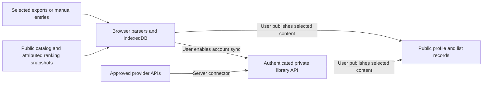

# Public distribution, user libraries, and community implementation plan

**Sequencing:** the [next-stage checklist](NEXT-STAGES-CHECKLIST.md) governs the
local MVP first. This document remains a later distribution proposal. Browser
file intake and portable dataset backup precede optional accounts/community;
none of those later features is a prerequisite for the personal trial.

Prepared 2026-09-11, Pacific/Tahiti; source checks continued on 2026-09-12 UTC. Status: proposal for later implementation. No repository visibility, deployment, account, or application behavior was changed. This plan complements the [current ranking audit](CURRENT-RANKING.md), [ranking plan](RANKING-IMPLEMENTATION-PLAN.md), and [backlog/progression plan](BACKLOG-IMPLEMENTATION-PLAN.md).

**1. Recommended product and distribution model**

Use a public source repository plus a hosted browser application, with optional cloud accounts and a connected community added in stages. Keep private, account-free use as a supported product mode. GitHub should serve contributors and people who want to run their own copy; the website should be the primary entry point for ordinary players.

The initial public experience should be: open the site, explore the sample or start an empty library, import a file or add games manually, then choose games to play. Import parsing and personal storage can happen entirely in the browser. A public website does not require uploading every user's library to a server. This requires implementation work; the present static snapshots do not already provide this experience.

| Option | Benefit | Cost or limitation | Recommended role |
| --- | --- | --- | --- |
| GitHub source and local setup only | Lowest service burden; user controls files; easy contributions. | Node/Python, exports, artwork, updates, and backup instructions create onboarding work; weak mobile access. | Supported early release and permanent self-hosting route. |
| Hosted app with browser-local imports | No developer tools or account required; same app available on multiple operating systems. | Each browser has separate data; clearing storage can lose it; imports initially manual. | Main first public product. |
| Hosted app with optional cloud sync | Cross-device history, Steam connection, account recovery, shared features. | Authentication, access controls, sync conflicts, support, and operating costs. | Add after import/tracking reliability is established. |
| Packaged desktop app | Convenient offline files and local integration. | Bundled runtime, platform packaging, signing, updates, and support. | Later, if local power-user demand justifies it. |
| Connected community website | Share selected lists, play challenges together, discuss discoveries. | Publication controls and moderation are ongoing work. | Start with public project content and discussions; expand gradually. |

Avoid separate implementations of ranking, imports, and progression for each channel. Use shared JavaScript domain modules with browser-local and optional server persistence adapters. Hosting and account features should be replaceable without losing the exported library format.

**2. What the repository supports today**

| Existing foundation | Publication implication |
| --- | --- |
| `scripts/build.mjs` emits sample-only `dist/`; `--local` emits personal `dist-local/`. | Only sample/public outputs belong in a public deployment. A personal snapshot is readable by everyone who can fetch its files. |
| `scripts/serve.mjs` binds localhost and uses explicit allowed paths. | Good local boundary; it is not a production account server. |
| `scripts/snapshot.mjs` supplies local generated JS or authored samples. | Replace hardwired personal globals with a dataset-loading interface for browser imports. Do not accept uploaded executable JS or reuse its VM evaluation for untrusted uploads. |
| Browser edits use origin-specific localStorage; backup covers edits. | New browser imports need IndexedDB, full library backup, migration, and recovery. Current backup does not restore the raw library/artwork by itself. |
| Playnite CSV and wishlist JSON are converted using Python tools. | Reuse their semantics and fixtures while introducing browser parsers; do not require a per-user server build. |
| Shared matching already distinguishes platform/edition ambiguity. | Preserve this conservatism in all connectors; imported names are not a reliable universal ID. |
| `.openai/hosting.json` selects static `dist/` for the existing Sites project. | Reuse this setup for a future approved static release. Its configuration does not prove current public access or support consumer accounts. |
| Read-only GitHub checks run share checks, tests, builds, and generated-file checks. | Extend the existing workflow for release artifacts; keep deployment a separate controlled step. |
| Optional Swift launcher opens a local checkout and requires an installed Node runtime. | It is not a ready cross-platform consumer installer. |

The npm `private` field prevents accidental package publication; it does not establish GitHub repository visibility. This plan did not inspect or change remote repository visibility. Making the source public and making the hosted app public are distinct release actions.

**3. User data intake strategy**

Treat Playnite as a valuable optional aggregator. Many users will have only Steam, physical console games, or manually recorded games. They should not need to adopt Playnite before trying this app.

| Intake | Initial support | Follow-up | Boundaries |
| --- | --- | --- | --- |
| Manual entry and generic CSV | First browser release. Title, platform, source, ownership/availability, optional identifiers. | Column mapping, bulk corrections, catalog search, custom titles. | Metadata gaps must not block managing a library. |
| Playnite export | First browser release; document one tested exporter and exact columns. | App-specific export extension with stable copy IDs and richer metadata. | Import selected game facts, not an entire authenticated Playnite installation. |
| Existing wishlist JSON | Maintain backward compatibility; publish a versioned app format and synthetic example. | An import adapter for a verified public wishlist source. | Current JSON expectations do not establish a Valve-supported export format. |
| Steam owned games | First account/connector release after a feasibility check. | User-requested refresh, freshness status, additions/removals preview. | Visible game details only; supported API/key access and partial results must be tested. |
| Steam wishlist connection | Optional experiment after verifying the interface. | Read-only synchronization if support and reuse terms are acceptable. | Do not promise parity with owned-game access or private wishlists. Keep file/manual fallback. |
| Other stores and consoles | Playnite, manual entry, and documented files initially. | Evaluate one direct connector at a time against user demand. | Do not assume a general public library API exists for every store. |
| Achievement services | Later progress evidence where supported. | Optional milestones or verified achievement labels. | Achievement/play history is not proof of current ownership or main-game completion. |

Playnite already aggregates several stores and supports extensions, making an export bridge a practical way to reuse that work. Its maintainer lists a simple library exporter; the Library Exporter Advanced author's repository documents configurable CSV export. These are candidate inputs, not proof that every exporter emits our present schema. Test and name supported versions, required fields, delimiter/encoding, and score scales. [Playnite](https://playnite.link/), [maintainer extensions](https://github.com/JosefNemec/PlayniteExtensions), [Library Exporter Advanced](https://github.com/darklinkpower/PlayniteExtensionsCollection)

For a later Playnite extension, export selected games to a versioned JSON file first. Include Playnite ID, external IDs when available, platform/store, distinct score sources, playtime units, and optional progress. Never include cookies, tokens, keys, local executable/ROM paths, or arbitrary plugin configuration. Artwork and notes should have explicit export choices. A subsequent account link can use a revocable, limited token with a preview of what will sync. Do not design the website to remotely scan a user's disk.

Steam OpenID verifies a SteamID and can link it to an app account. It is not blanket permission to retrieve a private library. `GetOwnedGames` documents visibility restrictions and excludes free games by default unless the played-free-games option is used. Check both account privacy and completeness; do not interpret inaccessible data as an empty collection. Publisher ownership methods for a developer's own apps are not a substitute for a general player-library connector. [Steam authentication](https://partner.steamgames.com/doc/features/auth), [owned games](https://partner.steamgames.com/doc/webapi/IPlayerService)

Keep the application's Steam key on the server. Valve's published terms call for user-requested retrieval, a privacy policy describing stored data and storage countries, and confidential API keys. Design manual refresh first, then explicit ongoing-sync consent, bounded caching and disconnect/delete controls. Do not ask users to paste Steam passwords or session cookies. [Steam API terms](https://steamcommunity.com/dev/apiterms)

This research did not verify a documented public Steamworks wishlist contract: the official API reference search did not establish one, and the candidate `IWishlistService` documentation page was unavailable. That is not proof that no usable endpoint exists. Before selecting a connector, verify its official/support status, privacy behavior, identifiers, pagination, missing fields, throttling, and permissions. Until then, describe it as experimental. Local wishlist decisions should remain separate from store modifications.

**4. Import, identity, and persistence contract**

Use the backlog plan's tracking targets, source references, owned copies, wishlist decisions, playthroughs, and activity records. Add the following implementation contracts:

- `ImportBatch`: schema/adapter version, source account or local namespace, import time, record counts, warnings, completeness, and applied revision. Keep individual source observation time distinct from import time.
- `SourceRecord`: provider plus external record ID, copy/release identity, permitted imported facts, raw score components, and provenance. An account-scoped source ID must not collide with another user's data.
- `UserOverride`: manual corrections and preferences that survive refresh. Imported fields and personal decisions have explicit precedence rather than one shared overwritten object.
- `SyncOperation`: stable operation ID, entity ID, base revision, change, and deletion tombstone. Duplicate delivery must not create duplicate progress or XP.

Ownership is distinct from access through a subscription, a family/shared library, installation, and a wishlist. Record what a source actually establishes. Unknown platform remains unknown. A removed source item becomes unavailable or needs review; it does not automatically erase notes or completed playthroughs. Never apply destructive replacement after an error, private response, partial page, or unexplained empty result.

Parse CSV/JSON as data in a worker with bounded file size, row count, and field lengths. Handle BOMs, quoted commas/newlines, Unicode, delimiters, numeric ranges and playtime units. Show a preview of additions, updates, unresolved matches, and removals before committing. Commit atomically; allow cancelling and rollback. Sanitize displayed fields, allow safe URL schemes, and prevent executable spreadsheet cells in CSV exports. Defer archive/artwork ingestion until decompression, path, type, and size limits exist.

Store imported datasets and tracking in IndexedDB; retain small UI preferences separately. Keep sample, guest, and signed-in account namespaces separate. A full portable backup should include user-authored records, source identifiers, and data needed to reconstruct the private view, subject to provider export permissions; provider caches and optional artwork can be omitted and re-fetched. State those exclusions in the UI. Export/import must work without an account or a functioning provider.

Moving from localhost to a public domain changes browser storage origin. Existing users must export/import; the site cannot silently read localhost data. Choose a stable production origin before the pilot. Add migration versions and persistence-failure messages. A future installable PWA may cache the public shell for offline use, but installation alone does not guarantee storage durability or background store refresh.

**5. Hosted architecture and privacy boundaries**

For the first release, the public host serves the application, catalog, samples, and permitted shared metadata. Personal files stay in the browser. External images/metadata requests can still reveal network activity to providers; explain that accurately and offer placeholders/local artwork where practical. Do not put private library contents in analytics, error reports, request URLs, or public caches.

For cloud accounts, add server-enforced user ownership on every read/write/export/delete and authenticated attachment route. Test two unrelated accounts against each other's IDs; a frontend login screen is insufficient. Use a maintained authentication implementation, session expiry/revocation, CSRF protection where applicable, and server verification of Steam OpenID responses. Linking and unlinking a provider must not silently merge two accounts. Allow a non-Steam sign-in path for console/manual users.

Cloud sync should preview guest-to-account merges. Use revisions and deterministic field rules; preserve conflicting notes and append-only play history. Do not resolve every conflict by overwriting the entire library with the latest upload. Logging out must detach account state from the guest namespace and offer a clear local-data choice. Account deletion covers private data and public projections, with documented backup expiry. Require a successful restore drill before offering cloud storage.

Keep public community records separate from private tracking, even if they share a database. A shared list is a selected projection with an explicit audience and fields. Use server authorization for private/unlisted access: an unguessable URL is not access control. Public pages are public and may be copied or indexed. Hide private notes, prices, account IDs, purchase dates, and activity timestamps by default. Preview the published result; support unpublishing and cache invalidation.

Encrypt traffic and use the hosting provider's storage protections, but do not claim end-to-end encryption without implementing it. Public source code does not make hosted operators unable to access stored libraries. Publish a plain-language data map and retention policy matching the implemented design.

**6. Hosting decision**

Keep the existing Sites static setup as the first candidate for the public browser release. This task only reviewed its local configuration and installed hosting guidance; it did not check live access, custom-domain eligibility, quotas, or production account capabilities.

GitHub Pages is an alternative for a static app or contributor-hosted copy. It serves static HTML/CSS/JS, so account storage, secret-bearing connectors, and moderated community writes need a backend elsewhere. A project Pages URL can include a repository prefix; test asset and navigation base paths before documenting it as supported. [GitHub Pages documentation](https://docs.github.com/en/pages/getting-started-with-github-pages/what-is-github-pages)

Before cloud implementation, run a small hosting proof of concept: one consumer login, two isolated private records, a permitted provider request with a server-only key, an export, deletion, and a public selected list. The installed Sites guidance describes Workers-compatible server builds and database/object bindings, but the current static configuration cannot use runtime bindings or migrations. Its generated sign-in helper is ChatGPT-oriented; do not assume it satisfies general consumer onboarding, Steam linking, or service ownership/portability requirements.

If the current host meets those requirements, extend it. Otherwise keep the frontend portable and select a managed auth/database/backend stack after that proof of concept. Record domain control, runtime compatibility, scheduled refresh support, storage regions, backup/restore, limits, exportability, and current prices. Forks must configure their own hosting project and secrets rather than reuse this preview's project configuration.

Do not hard-code a cost promise before selecting the service. Model monthly cost from active users, average library size, stored history, refresh frequency, unique catalog games, permitted artwork traffic, email, and moderation time. Cache reusable game metadata by provider product ID and locale; keep user ownership responses private. Prioritize on-demand refresh over repeatedly fetching every user's library. Establish a budget alert, request limits, and a connector kill switch before enabling broad synchronization.

**7. Community features and progression**

Begin with the project website, a clear methodology page, change log, import guides, and a place to discuss discoveries. GitHub Discussions supports categories, questions, polls, and contributor conversations with little custom implementation. It does require a GitHub account to participate and its visibility follows the repository, so use it as the initial forum without requiring GitHub for private app use. [GitHub Discussions](https://docs.github.com/en/discussions/quickstart)

Build app-native community features in this order:

1. **Published lists and optional profiles.** “My five games this season,” finished-game reflections, favorite system lists, and selectable completion cards. Show edition/platform, ranking mode, and snapshot date so shared ranks remain interpretable.
2. **Shared retro challenges.** System passports, genre bingo, and a monthly game club based on owned or freely accessible choices. Freeze eligibility/rules when a challenge starts; people can track privately and selectively share milestones.
3. **Follows and small clubs.** An opt-in feed of deliberately published activity, shared recommendations, and club challenges. Avoid automatically broadcasting imports or every playtime update.
4. **Community ratings and comments.** Add only with moderation capacity. Label community ratings separately from external reception and personal play priority; display sample size and apply an evaluated small-sample method. Do not let a tiny early community replace the catalog's ranking foundation.

Private XP and achievements can use the backlog plan's local rules. Shared badges must identify self-reported versus provider-evidenced events. Server validation can prevent duplicate awards but cannot prove a manually claimed finish. Prefer cooperative goals and personal milestones over competitive global XP leaderboards. Never reward purchases, bulk imports, or rating spam.

Before accepting public user content, implement report/block, moderator roles and audit history, spam/rate limits, safe text rendering, account restrictions, and an appeal/contact route. Defer direct messages, arbitrary uploads, and a custom real-time chat system. Assign someone to handle reports; software alone does not provide moderation coverage.

**8. Release work packages and acceptance gates**

Sizes indicate relative engineering scope, not delivery promises. Complete each gate before exposing its dependent capability.

| Package | Size / dependencies | Deliverable and acceptance gate |
| --- | --- | --- |
| **P0: Public-source readiness** | Small–medium; independent. | Audit current tracked files and repository history/refs/release assets for personal data and secrets; inspect artwork/data provenance separately from code licensing. Prepare clean source/sample release, actual export instructions, troubleshooting, support/security contacts and changelog. A clean checkout passes share checks, tests, and build. Publishing remains a later explicit release action. |
| **P1: Shared browser dataset layer** | Large; coordinate with backlog R1-A. | Dataset loader, pure import/matching modules, IndexedDB, full backup, safe migrations, manual entry, and existing file compatibility. Old CLI and new parser fixtures agree on relevant facts. No user decision or score component disappears silently. |
| **P2: Public browser beta** | Medium after P0/P1 and basic backlog R1-B. | Onboarding with sample/empty/import choices; personal data stays local; private-data network checks; keyboard and mobile smoke tests; stable origin and guides. Pilot users import, choose an owned game, save progress, and restore a backup without developer tools. Publish named legacy ranking modes until new evidence is ready. |
| **P3: Accounts and cloud sync** | Large; after P2 usability pilot and hosting proof of concept. | Optional consumer auth, private API, guest merge, offline conflict recovery, full export/delete, backups, operational limits. Two-account isolation, retries, logout/account switching, failed writes, schema migration, restore, and deletion tests pass. |
| **P4: Steam and Playnite convenience** | Medium–large; file exporter can precede P3, cloud connectors depend on it. | Tested Steam ownership connector and versioned Playnite export bridge; last-successful-sync status and per-source disconnect. Handle private, empty, partial, throttled, unavailable and renamed-source cases without data loss. Wishlist automation only after its separate feasibility gate. |
| **P5: Connected community** | Large; P3 plus public-content controls and named moderator. | Selective profiles/lists and cooperative challenges, then follows/clubs. Anonymous access reveals only published fields; unpublishing removes active public output; abuse handling works. Reference frozen ranking/challenge versions. |
| **P6: Optional expansion** | Demand-driven after earlier releases. | Desktop packaging, installable offline experience, additional stores, ratings/comments, richer discovery. Choose one expansion with evidence of demand; retain import/export and self-host operation. |

P0 can deliver a useful GitHub release before the hosted personal app is ready. The recommended first consumer milestone is P2. P3–P5 should follow evidence that people successfully use the private product, rather than being prerequisites for trying it.

For public-source distribution, validate on Windows as well as macOS/Linux; the current launcher is Mac-specific and Bash wrappers are not universal. Document supported export versions and shell alternatives, then consider a bundled local release. If shipping installers, add signed release artifacts, checksums, update/rollback behavior, and platform-specific signing/notarization where appropriate. Do not label the present launcher a standalone Windows application.

**9. Concrete code boundaries and validation**

Suggested module locations are implementation starting points, not required framework choices:

| Area | Existing anchors | Proposed work |
| --- | --- | --- |
| Dataset loading | `scripts/snapshot.mjs`, `library/app.js`, `library/wishlist.js`, `app.js` | `imports/` adapters and a browser dataset repository; retain sample/local CLI compatibility. |
| Shared domain | `library/core.js`, `lib.js`, `scripts/connect-library.mjs` | Reuse backlog `tracking/` records and conservative identity mapping; expose pure logic to CLI/browser/server. |
| Rankings | Python builders, `library/tools/steam_meta.py`, catalog builder | Implement ranking K1 source preservation with new import formats; use versioned evidence snapshots as K2–K4 arrive. |
| Backend later | None currently | Auth-scoped library/sync APIs, connector workers, provider cache, selective publication API, migrations, and operational controls. |
| Build and navigation | `scripts/build.mjs`, `scripts/serve.mjs`, navigation template/sync | Explicitly include new modules and routes, update sample isolation checks, and test hosted base paths. |
| Documentation/release | README, library guide, CONTRIBUTING, GitHub checks | Versioned import guide, data format reference, restore guide, support policy, release artifacts and deployment runbook. |

Use synthetic fixtures, never committed personal exports. Essential cases include two copies with different scores; ambiguous editions; repeated imports; a missing provider field; inaccessible versus empty source; a removed subscription game; Unicode CSV; huge/corrupt file; storage failure mid-import; migrated localhost backup; concurrent offline edits; and two-account authorization attacks. Verify that no selected file contents leave the browser in local mode, including logs and telemetry. Restrict executable content and untrusted artwork URLs.

For deployment, retain the sample-only build boundary and add a synthetic private-marker regression check against the actual public artifact. Never deploy `dist-local/` or hide a shared personal snapshot behind a cosmetic login. Verify the output, then use the selected host's release process and rollback plan. For the existing Sites project, follow its current hosting workflow and resolve access before publication.

Pilot success should be measured by import completion, correct matching, time to the first selected game, successful backup restoration, and return usage. Collect feedback or minimal opt-in metrics without recording library titles, private notes, or raw imports. Set numerical targets after the first pilot supplies a baseline. Community follower counts and GitHub stars are not substitutes for a reliable personal library.

**10. Decisions to carry into implementation**

Recommended defaults are: public source plus a browser-first product; manual/CSV and Playnite support first; guest IndexedDB storage first; optional accounts; Steam as the first direct store connector; read-only store integration; private libraries by default; selected lists and cooperative challenges as the first native community features.

Decide later, at the relevant release gate: production domain and operator; exact tested exporter versions; the cloud host/auth method and storage region; operating budget; source/data/artwork redistribution permissions; moderator ownership; wishlist connector feasibility; and whether a packaged desktop app has enough demand. Keep VGC attribution and reuse constraints from the ranking plan intact when caching or sharing ratings. None of these decisions requires rewriting the private library domain model if the boundaries above are preserved.
